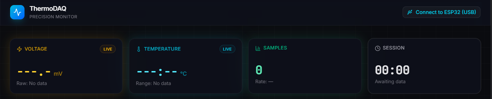
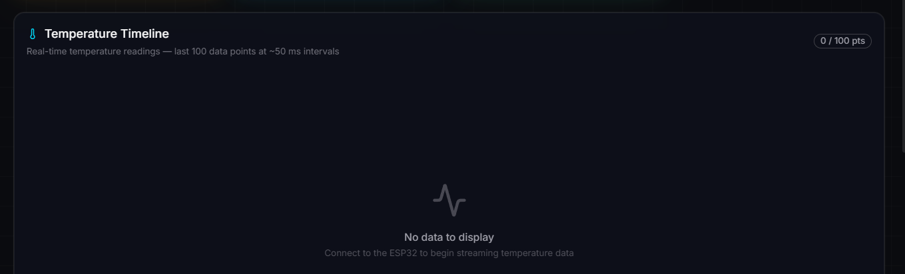
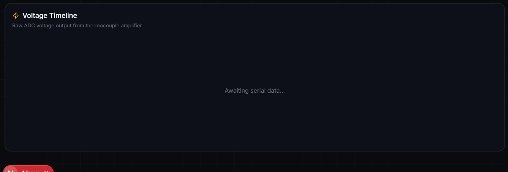

# ThermoDAQ

### Real-Time Temperature & Voltage Monitoring

ThermoDAQ is a browser-based data acquisition dashboard for a USB-connected ESP32. It reads sensor measurements through the Web Serial API and displays live temperature, voltage, and session statistics alongside interactive charts.

**Live deployed project:** `https://thermodaq.pages.dev`

## Project Showcase

### Live Readings



### Temperature Timeline



### Voltage Timeline



## Features

- **USB serial connection:** Connect to an ESP32 directly from the dashboard at 115,200 baud.
- **Live readings:** View temperature in degrees Celsius and voltage in millivolts, with raw voltage also shown in volts.
- **Interactive charts:** Explore temperature and voltage timelines with tooltips and a rolling window of the latest 100 readings.
- **Session statistics:** Track sample count, estimated samples per second, elapsed session time, and minimum/maximum temperature.
- **Temperature trend:** View a rising or falling indicator based on the latest two readings.
- **Streaming JSON parser:** Buffer partial serial messages and skip malformed JSON or records missing numeric fields.
- **Responsive dark interface:** Reusable UI components, color-coded charts, and connection status feedback.

## Tech Stack

| Area | Technology |
| --- | --- |
| Framework | Next.js 16, React 19 |
| Language | TypeScript |
| Styling | Tailwind CSS 4 |
| UI components | shadcn/ui, Base UI |
| Charts | Recharts |
| Icons | Lucide React |
| Device communication | Web Serial API, Streams API |

## Getting Started

### Prerequisites

- Node.js 20.9 or later and npm.
- A browser exposing the Web Serial API; the app directs users to Chrome or Edge.
- For live measurements, an ESP32 connected with a USB data cable and firmware that sends the JSON format below.

### Run Locally

From the project directory:

```bash
npm install
npm run dev
```

Open [localhost:3000](http://localhost:3000).

The current application requires no environment variables or database setup. You can view the interface without hardware; charts populate when valid serial readings arrive.

### Production Build

```bash
npm run build
npm start
```

### Available Scripts

| Command | Purpose |
| --- | --- |
| `npm run dev` | Start the development server |
| `npm run build` | Create a production build |
| `npm start` | Serve the production build |
| `npm run lint` | Run ESLint |

## Connecting an ESP32

1. Configure the ESP32 firmware to transmit newline-delimited JSON at **115200 baud**.
2. Connect the board to your computer using a USB data cable.
3. Open the dashboard and click **Connect to ESP32 (USB)**.
4. Select the board's serial port in the browser's device picker.
5. Watch the readings and charts update. Click **Disconnect** to end the session.

### Expected Serial Data

Send one JSON object per line, terminated by a newline (`\n`):

```json
{"time":1000,"voltage":0.0254,"temp":32.75}
```

| Field | Type | Expected unit / meaning |
| --- | --- | --- |
| `time` | Number | Device timestamp in milliseconds; displayed as seconds on the charts |
| `voltage` | Number | Voltage in volts; converted to millivolts for display |
| `temp` | Number | Temperature in degrees Celsius |

The dashboard displays the temperature supplied by the device; it does not calculate temperature from voltage. The chart description assumes approximately 50 ms between readings, but the actual transmission rate is controlled by the firmware.

ESP32 firmware, wiring instructions, and sensor calibration are not included in this repository. Measurement history is held in browser memory, with only the latest 100 points retained for charts. There is no database storage or export feature.

## Project Structure

```text
public/
  projectPics/          # Dashboard showcase screenshots
src/
  app/
    page.tsx           # Dashboard, serial connection, parsing, and charts
    layout.tsx         # App layout, fonts, and metadata
    globals.css        # Global styles and dashboard theme
  components/
    ui/                # Button, card, and badge components
  lib/
    utils.ts           # Shared styling utility
  types/
    web-serial.d.ts     # Web Serial API TypeScript declarations
```

## Troubleshooting

- **Unsupported browser message:** Use a browser that exposes `navigator.serial`, as required by the application.
- **Unable to open the port:** Check the USB cable and selected port, and close any serial monitor using the same device.
- **Connected but no readings:** Confirm that the firmware uses 115200 baud and sends newline-terminated JSON with numeric `time`, `voltage`, and `temp` fields.
- **Unexpected voltage scale:** Send `voltage` in volts. The dashboard multiplies it by 1,000 when displaying millivolts.
